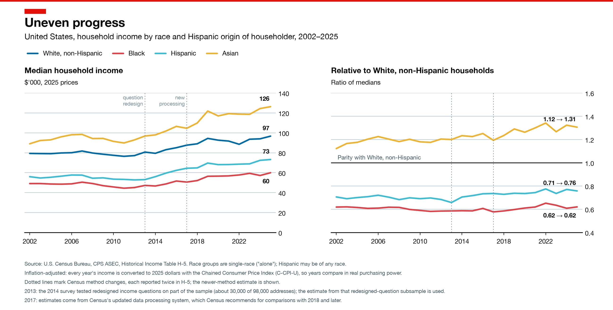

# Household income gap by race in the US, 2002–2025



## The figures

There are two figures with the same layout, one for median and one for mean household income:

- [`figures/income_gap_by_race.png`](figures/income_gap_by_race.png) (median, shown above)
- [`figures/income_gap_by_race_mean.png`](figures/income_gap_by_race_mean.png) (mean)

Each has two panels:

- **Left:** real household income, in thousands of 2025 dollars, for White non-Hispanic, Black, Hispanic and Asian households.
- **Right:** each group's income as a ratio of the White non-Hispanic figure.

Ratios to White non-Hispanic households, 2002 → 2025:

| | Median | Mean |
|---|---|---|
| Black | 0.62 → 0.62 | 0.64 → 0.65 |
| Hispanic | 0.71 → 0.76 | 0.72 → 0.74 |
| Asian | 1.12 → 1.31 | 1.13 → 1.27 |

Means are pulled up by the highest incomes, so they are more sensitive than medians to how Census caps (top-codes) very large incomes.

## Data

The data come from the U.S. Census Bureau's [Historical Income Table H-5](https://www.census.gov/data/tables/time-series/demo/income-poverty/historical-income-households.html), *Median and Mean Household Income by Race and Hispanic Origin of Householder*, based on the Current Population Survey Annual Social and Economic Supplement (CPS ASEC). The latest release covers income through 2025.

FRED has only the all-races total (`MEHOINUSA672N`), not the race breakdown, so the scripts download H-5 from Census directly.

Choices made in `get_data.py`:

- **Years:** 2002 onward. That is the first year of the single-race ("alone") categories, so every year in the series uses the same definitions.
- **Inflation:** incomes are in 2025 dollars, converted by Census with the Chained Consumer Price Index (C-CPI-U). The nominal values are kept in the CSV as well.
- **2013 and 2017:** H-5 reports each of these years twice because of method changes (a redesign of the income questions, then a new processing system). The scripts keep the newer-method estimate.
- **Reference group:** White non-Hispanic. "White alone" includes most Hispanic households, which would blur the Hispanic comparison. Hispanic households may be of any race.

## Rerunning

Set up the environment once:

```bash
python3 -m venv .venv && .venv/bin/pip install -r requirements.txt
```

Then download the data and draw the figure:

```bash
.venv/bin/python get_data.py && .venv/bin/python plot.py
```

## Files

| File | What it does |
|---|---|
| `get_data.py` | Downloads H-5 to `data/raw/h05.xlsx` and writes `data/household_income_by_race.csv` (one row per group and year) |
| `plot.py` | Reads the CSV and saves the median and mean figures in `figures/` |
| `requirements.txt` | Python packages: pandas, openpyxl, matplotlib, requests |
